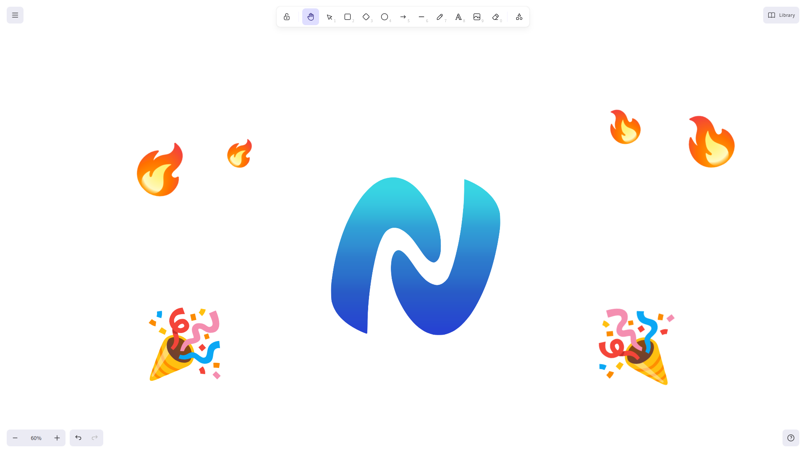

# Excalidraw

Draw together on the same whiteboard, from inside the voice room: one board per
room, every stroke as it happens.

## How it works

1. Open **Excalidraw** in the voice room you are in.
2. Draw: the others see the line while your hand is moving, and the shape the
   moment you let go.
3. That is it. Nobody hosts the board and nobody has to accept anything: anyone
   can add, move, erase, write, change the background.

The board is the room's, not a file someone owns. Close the activity and it is
still there when you come back, on every device.

## What you get

- the full Excalidraw toolbox: pen, shapes, arrows, text, frames, eraser,
  libraries;
- live previews of the other hands, with their names on the pointer;
- the same background and grid for everyone;
- English and Italian, following the language of the app;
- nothing loaded from the internet: the fonts are part of the plugin, so the
  board opens with the network down.

## What is yours alone

Zoom, scroll and the tool in hand stay on your screen: moving the canvas moves
only yours, so nobody can drag the board away from under the others.

## Limits

- **Images and embeds** added to the board are not shared yet: they stay on the
  device that added them.
- A room can hold a lot of drawing, but not an infinite one: the log of the
  room is trimmed at some point, and the oldest strokes are the first to go.
- The board is deleted with the room, it is not an archive.
