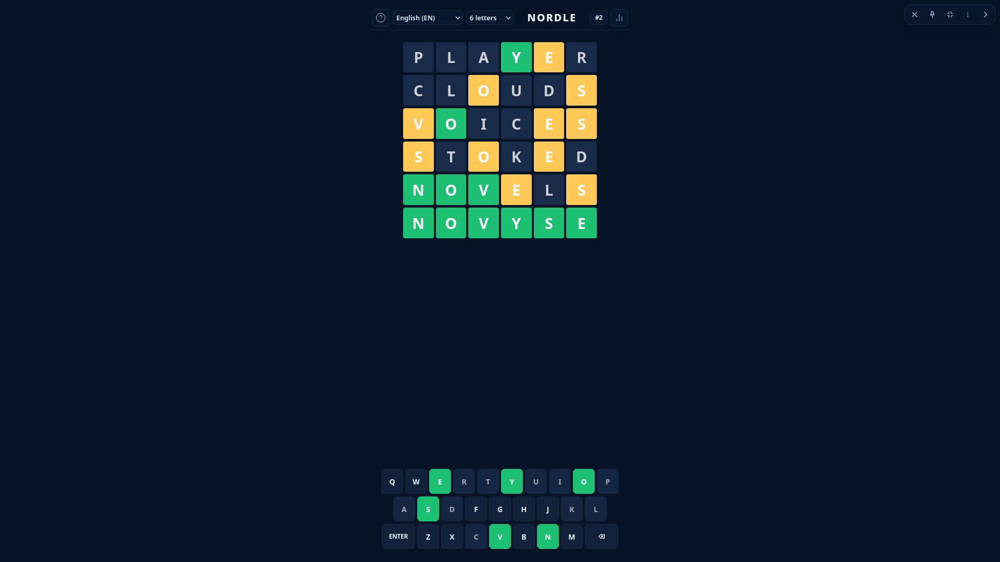

# Nordle

A shared, multilingual word guessing game for voice rooms: choose between 65 languages, customize word lengths from 2 to 15 letters, and guess together in real time.

## Features

- **65 Languages Supported**: Play in English, Italian, Spanish, French, German, Russian, Ukrainian, Arabic, Persian, Hebrew, Greek, Turkish, Korean, and 52 more languages.
- **Customizable Word Length**: Choose any word length from 2 to 15 letters. The board, letter tiles, and input grid automatically scale to fit the viewport.
- **Native Keyboard Layouts**: Every language includes its authentic native keyboard layout (e.g. Cyrillic JCUKEN, Greek, Arabic, Hebrew, German QWERTZ, French AZERTY, and Italian with accented keys `à, è, é, ì, ò, ù`) as well as full physical keyboard typing support.
- **Real-Time Room Synchronization**: Every letter typed, deleted, and submitted guess is synchronized instantly with all participants in the voice room over the persistent state channel.
- **Infinite Rounds**: Play round after round. Each game uses a synchronized random seed so every participant plays the exact same secret word.
- **Rich Dictionaries & Fast Loading**: Over 785,000 verified words across all supported languages. Word lists are loaded dynamically on demand, keeping memory and network usage minimal.
- **Seamless Late Joining**: Anyone who joins the room mid-game catches up instantly with the current round, attempts, evaluations, and game status.
- **Novyse Theming & Collapsible Controls**: The board, letters, and tiles automatically adapt to the room's color scheme (light, dark, AMOLED, or custom palettes). Pin, Close, and Fullscreen controls can be collapsed into a compact corner dot.

## How to use it

- The game starts in a **waiting screen** until the room is ready.
- Choose your preferred **Language** and **Word length** from the selectors at the top.
- Anyone in the room can press **Inizia Partita** (Start Game) to begin the round.
- Type letters using either your physical keyboard or the on-screen native keyboard.
- Press **Invio** / **Enter** to submit a guess. If the word is valid, the tiles flip to reveal:
  - 🟩 **Green**: The letter is in the correct position.
  - 🟨 **Yellow**: The letter is in the word but in a different position.
  - ⬛ **Gray**: The letter is not in the word.
- The room has **6 attempts** to guess the hidden word.
- When the round ends (win or loss), the secret word is revealed along with the round summary and a **Nuova Partita** (New Game) button to immediately roll a new secret word and start the next round together.

Limits: one instance per voice room, and up to three activities can run simultaneously in the room.
