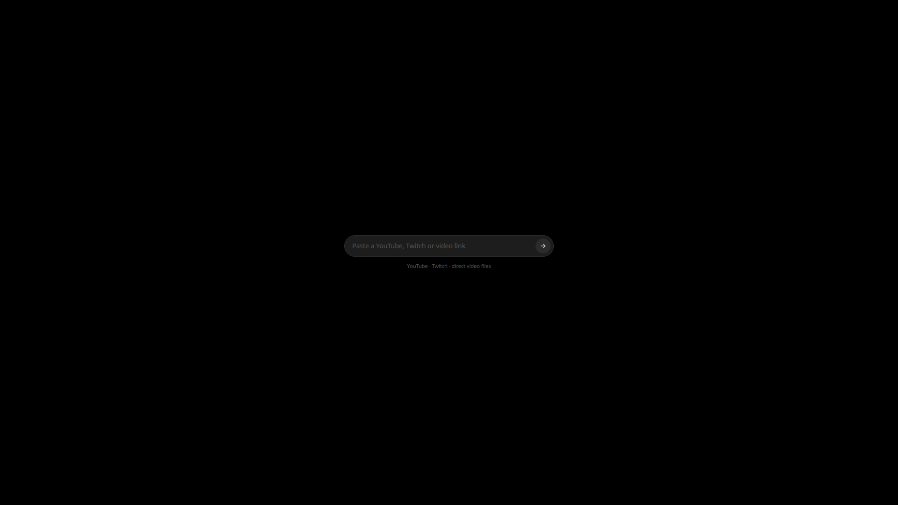

# Developing Watch Together

The notes that used to live in the README: how links are rendered, how the sync
works, and what the two embeds need. The README is the store page, keep it
user-facing.

## What you can paste

One input, three kinds of link, and the platform is shown while you type:

| Link | Rendered by |
| --- | --- |
| `youtube.com/watch?v=…`, `youtu.be/…`, `/shorts/…`, `/live/…` | the YouTube IFrame Player API, inside `frame-src` |
| `twitch.tv/<channel>` (live), `twitch.tv/videos/<id>` (VOD) | the official Twitch embed, with its own UI |
| `https://…/video.mp4` (also `webm`, `m4v`, `mkv`, `ogv`, `mov`) | the app, with media_kit, above the sandbox |

Anything else is refused before it reaches a player. Video files must be
`https`: they are streamed by the native player, not by the sandbox.

Twitch clips are not supported: a clip is neither a channel nor a video, and
the embed API treats them differently.

## How the sync works

One `STATE` event type only, `PLAYBACK`, carrying the full intent:

```ts
{
  source: { kind: 'youtube', url: 'https://www.youtube.com/watch?v=…', videoId: '…' },
  playing: true,
  position: 42.5
}
```

`position` is the position at the moment the server stored the event (`ts`).
From there the expected position is `position + (serverNow - ts)`, so a client
that joins late, or one that missed a few seconds of socket, computes the same
frame as everyone else without asking anybody.

- **late joiner**: `init().state.events` → the last `PLAYBACK` wins → the player
  is loaded at the extrapolated position;
- **position**: a position is applied once, when a new `PLAYBACK` event arrives;
  from there the player advances on its own, so buffering is never mistaken for
  a drift and seeked in a loop;
- **intent**: a play, a pause or a seek made with the player's own controls is
  published as a new `PLAYBACK`; a programmatic move is never published back,
  so the room does not bounce. A seek is detected by the tick, because neither
  the YouTube nor the Twitch API has a seek event that can be trusted;
- **anyone controls**: there is no host client. Anyone with the activities
  permission sends a `PLAYBACK`; the server stamps `seq`, `sender` and `ts` and
  the event comes back to the sender too, which reconciles instead of
  double-applying.

A Twitch **live** channel has no position: only play and pause are synced, and
every client sits at the live edge by itself.

## The app player

The sandbox cannot decode video, so a file link is not played in the plugin:

```ts
await sdk.player.open('https://cdn.example/video.mp4');
```

The app mounts `PluginNativePlayer` (media_kit) above the sandbox, paused, with
its own minimal controls and a back button. The back button closes the player
and emits `activity:player { state: 'closed' }`, which the plugin receives as
`sdk.player.onClosed`: the tile is back on the first screen. The WebView stays
mounted underneath, so the plugin keeps receiving the state of the room.

The controls of that player are not a room of the app: `sdk.player.onIntent`
reports a play, pause or seek made with them, and the plugin publishes it as a
`PLAYBACK` like any intent of an embed. The host does not write anything and
does not invent a vocabulary, so a `file` follows the same code path as
YouTube and Twitch, and a plugin that needs a faster channel is free to use
`action.send` instead.

The native player is not available in the browser harness: `player.open`
rejects with `E_UNSUPPORTED` there, and the plugin says so. File playback has to
be tested inside the app.

## YouTube specifics

- The document is served from `http://127.0.0.1:<port>` on native and from an
  opaque origin on the web, so the API can refuse to answer; the tile then says
  so instead of showing a black rectangle.
- A browser may refuse `playVideo()` without a user gesture. Nothing is forced:
  the local user taps play on the player itself, and that event is published
  like any other intent.
- The video id is passed when the player is created, so the iframe is
  `/embed/<id>`. A player created empty and then fed with `loadVideoById`
  answers the API but does not always buffer: poster, no playback.
- A stream without a duration is live: it is never seeked (second 0 of a
  stream started hours ago is a black screen), only play/pause is synced.

## Twitch specifics

The official embed needs a `parent` that matches the domain hosting the frame.
Native uses the loopback server of the app (`127.0.0.1` and `localhost` are both
declared); on the web the sandbox lives in an opaque document, so the ancestor
is read from `document.referrer`. When no domain can be declared the plugin
refuses the link instead of rendering the error page of Twitch.

## Languages

The UI is translated in the bundle: `init().locale` carries the language of the
app (`it-IT`, `en-GB`, ...), `src/i18n.ts` matches its base and falls back to
English. The manifest declares both:

```json
"locales": ["en", "it"]
```

`npm run dev?lang=it` switches language without touching the system.

## Store page

- `store/icon.png`, 512×512 logo, transparent background;
- `store/banner.png`, 1600×600 banner;
- `store/screen-1.png`, `store/screen-2.png`, 1920×1080 screenshots, shown by
  the plugin page through `README.md`, stacked.

The paths in the README are absolute because the page renders the file from
`raw.githubusercontent.com`:

```md

```

## Develop

```sh
npm install
npm run dev
```

Two tabs = two participants: load a link in one and it appears in the other.
YouTube and Twitch work there; a file link will say it needs the app.

## Build and publish

```sh
npm run build
cd ../..
node scripts/bundle.mjs watch-together --update-registry
```

`npm run build` writes `dist/index.html` and `dist/manifest.json`; the bundler
zips `dist/`, updates `registry.json` and prints the digest.
