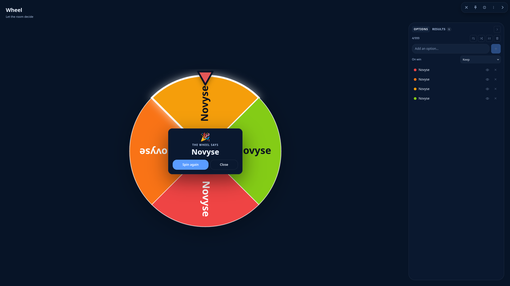

# Wheel

A shared wheel of fortune for the voice room: write the options once, spin, and everyone lands on the same result.

## How to use it

- The wheel starts empty: the options belong to the room, so there is no stock list to delete first.
- Add, remove, hide, sort or shuffle the options in the list on the right. The eye keeps an option in the list but off the wheel; the crossed eye brings it back.
- **Clear** empties the wheel only after a confirmation, so a misclick does not cancel the game.
- **On win** decides what happens to the winner as soon as the result appears: **Keep**, **Hide** (it stays in the list but leaves the wheel) or **Remove** (it is deleted). The change reaches every client.
- Press **Spin** in the middle of the wheel. The spin is published to the room: every participant sees the wheel turn and stop on the same option.
- The result appears as a card, with a **Spin again** button.
- The **Results** tab next to Options lists the winners in order, newest first. Its trash button clears the history without touching the options.
- **Import / Export** opens a modal with a JSON array of strings. A comma inside a phrase stays in that option, so `["ciao, sono gay", "ciao sono granco"]` is two options. Import replaces the current list.
- The arrow in the panel header collapses the options; the panel button in the header reopens them and gives the wheel more space.
- Close, **Pin** and **Full screen** are the buttons in the top-right corner, with the context menu beside them; the arrow in that corner folds them into a single dot when you want the whole surface back. The tile is the whole activity, with no bar of the app around it.
- A late joiner sees the current options, the result history, and either catches the end of a spin in progress or finds the result already on screen.
- Up to 999 options, 40 characters each. With very long lists the slices keep their colours but the wheel stops drawing labels, which would be unreadable at that density; the list remains the reference.

The random index is chosen with the browser crypto API, so the result is not tied to the animation or to the client clock.

Limits: one instance per room, and up to three activities can run at once. The room state is capped at 16 KiB, so an extremely long list can exceed the payload before reaching 999 entries.
